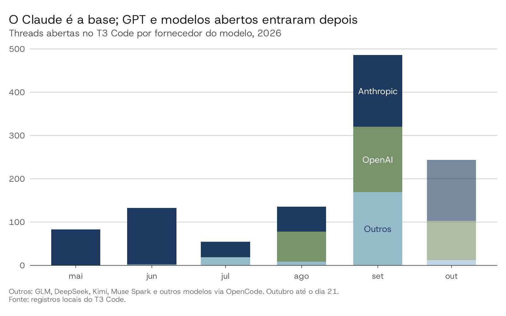
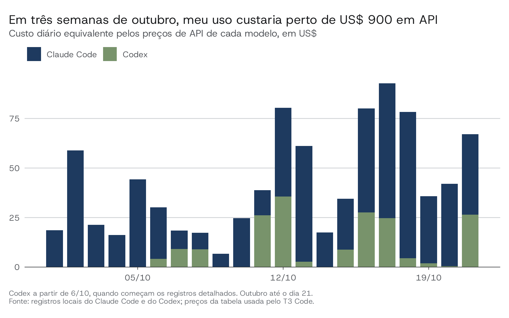

# Meu setup atual {#sec-setup}

<!-- Rascunho 2, a partir da entrevista 1 (_drafts/entrevistas/01-setup.md)
     e dos dados de uso. Marcações [?] pedem resposta na próxima rodada. -->

Eu trabalho com IA de dois jeitos. No primeiro, eu delego: desenho uma tarefa, entrego para um agente e reviso só o resultado final, como um gerente de projeto revisa o trabalho de um analista. No segundo, eu controlo: escrevo, testo e ajusto o código com o agente ao lado, chamado quando preciso. Cada jeito tem a sua ferramenta. Delego no T3 Code e controlo no Positron. O resto deste capítulo descreve as duas, os modelos que uso em cada uma e quanto isso custa.

## Delegar e controlar

O T3 Code recebe o trabalho que já está consolidado: um pacote com estrutura definida, uma refatoração com escopo claro, uma limpeza de repositório. É uma interface para conversar com agentes, sem editor de código no centro. Resisti a ele por muito tempo, porque me parecia estranho programar sem um script aberto. Hoje entendo que essa estranheza é justamente o ponto: o T3 Code me coloca em outra postura. Em vez de escrever código, eu escrevo pedidos longos, distribuo tarefas entre modelos e acompanho vários projetos ao mesmo tempo.

Três coisas me prenderam ao T3 Code. Escrever um pedido longo é mais confortável nele do que no terminal. Trocar de modelo no meio do trabalho é simples: começo com o GLM 5.3 Flash, passo para o Opus e termino com uma revisão do GPT. E ele não me interrompe a cada passo pedindo permissão para ler um arquivo ou rodar um comando. Esse último ponto pesa mais do que parece. O OpenCode, por exemplo, não tem um modo automático equivalente, e por isso quase não o uso diretamente; prefiro usar os mesmos modelos abertos dentro do T3 Code.

O Positron recebe o trabalho em que eu quero a mão no volante: relatórios, textos, visualização de dados e entregas importantes para clientes. Nele, uso o Claude pela extensão do editor ou pelo Claude Code no terminal integrado. Assim consigo escrever, rodar um trecho, ver o gráfico, revisar a mudança do agente e voltar a escrever, tudo na mesma janela. Quando é mais fácil ajustar do que explicar, fico no Positron.

## Os modelos

O Claude é a minha base, hoje com o Opus 5.5 em esforço médio. Comecei com ele porque já achava o Claude melhor em R do que o ChatGPT, e essa parecia ser a opinião da comunidade. Os engenheiros da Posit que eu acompanho usavam o Claude, o Hadley Wickham parece preferi-lo, e o Posit Assistant foi lançado só com modelos da Anthropic.

O caminho até aqui não foi tranquilo. Durante muito tempo, o Claude era mais rápido do que eu, mas o código era fraco e ele construía demais. Eu gastava tempo limpando o que ele deixava: funções que ninguém pediu, documentação inchada, exemplos desnecessários. Oscilei entre microgerenciar o agente, o que parecia perda de tempo, e confiar demais, até me queimar. Numa dessas, um modelo da Anthropic quase apagou um pacote inteiro, o `realestatebr`. [? Que modelo era e quando foi? "Opus 3.5" não existiu; talvez Claude 3.5 Sonnet ou Opus 4. O que você mudou depois disso?]

O Opus 5.5 mudou essa relação. Ele me entende bem e programa bem de verdade. Pela primeira vez, passei a tratar a IA como um colega de trabalho, e não como um assistente que precisa de supervisão linha a linha. É essa mudança que torna possível o modo "delegar" da seção anterior.

O GPT entrou em agosto, quando o Opus 5 me pareceu estagnado e comecei a ouvir coisas boas do GPT 5.6. Hoje uso três modelos da OpenAI, cada um para uma coisa:

- GPT 6 Sol para programar, no lugar do GPT 5.6 Sol, que usei muito em esforço baixo ou médio.
- GPT 6.1 Sol para revisar pull requests importantes. É caro demais para o dia a dia na assinatura Plus.
- GPT Luna para quase tudo que não é código: pesquisa, texto, organização de ideias.

Escolho entre eles pela cota que cada um consome, não pela velocidade. O GPT 6 Astra merece uma nota: usei muito para gerar imagens e para controlar o computador, mas o Sonnet 5.5 o substituiu nessa última tarefa.

Os modelos abertos ficam com o trabalho braçal. O GLM 5.3 Flash me mostrou como um modelo pequeno e eficiente pode ser capaz. Uso-o para reescrever textos, escrever descrições de pull requests, organizar pastas, procurar arquivos e limpar repositórios, apagando branches, worktrees e documentos antigos. O Muse Spark me surpreendeu até em código R, embora eu desconfie de que ele se beneficiou de rodar num repositório bem organizado e com as minhas skills. Usei pouco o DeepSeek V4 Flash, e o Kimi me pareceu capaz, mas caro demais.

## Instruções compartilhadas

Os dois agentes leem o mesmo arquivo de instruções globais, `~/.agents/AGENTS.md`. O `CLAUDE.md` do Claude Code apenas importa esse arquivo. Ele diz quem eu sou, o que eu já sei, quando o agente deve me perguntar antes de agir e como eu quero que ele escreva. Regras mais longas ficam em arquivos separados: uma para código R (tidyverse, pipe nativo, `cli`, `here`) e duas para texto em português e em inglês. Cada projeto tem ainda o seu próprio `CLAUDE.md`, com o objetivo do projeto e as convenções locais. O @sec-contexto explica como esses arquivos se combinam.

## Skills e MCPs

[? Esta seção ainda depende da próxima rodada da entrevista: quais skills e MCPs você usa de fato.]

## Meu uso em números

Os agentes guardam registros locais de cada conversa: modelo, interface e tokens consumidos. Juntei esses registros com um script em R para ver como eu realmente uso IA, e não como eu acho que uso.

{fig-alt="Gráfico de barras empilhadas com o número de threads abertas no T3 Code por mês de 2026, por fornecedor do modelo. Até julho quase todas usam modelos da Anthropic. A OpenAI aparece em agosto. Em setembro o total passa de 480 threads, cerca de um terço com modelos abertos."}

O gráfico confirma a história acima. O Claude está em todos os meses, a OpenAI entra em agosto e setembro foi o mês em que mais testei modelos abertos. Em outubro, com o Opus 5.5, o Claude voltou a ocupar a maior parte do trabalho.

{fig-alt="Gráfico de barras empilhadas com o custo diário equivalente em API do Claude Code e do Codex de 1 a 21 de outubro de 2026. A maior parte do custo vem do Claude Code; alguns dias passam de US$ 75."}

Em três semanas de outubro, o mesmo uso pago pela API custaria perto de US$ 900. Eu pago US$ 40 por mês, somando o Claude Pro e o ChatGPT Plus, ou cerca de . A maior parte do custo vem de tokens lidos do cache: o agente relê o contexto da conversa a cada passo, e o cache é o que torna isso barato. O @sec-llms explica por quê.

## Quanto custa e como administro os limites

Pago duas assinaturas de US$ 20: Claude Pro e ChatGPT Plus. Quase sempre esgoto as duas. Quando o limite de uma acaba, sigo uma ordem: Claude, depois GPT, depois o OpenCode Go e, por último, o OpenCode Zen, que cobra por uso. O OpenCode Go está pausado no momento, mas pretendo voltar. Acompanho o consumo de cada assinatura com o CodexBar, um aplicativo que mostra os limites na barra de menus do Mac.

Administrar limites ficou mais fácil nos últimos meses. Em parte, porque a Anthropic e a OpenAI passaram a renovar as cotas com mais generosidade. Em parte, porque o Opus 5.5 em esforço médio gasta pouco para o que entrega. Mesmo assim, uso alguns truques simples:

- Logo cedo, mando um "olá" para o Haiku e para o Luna. A janela de limite de cinco horas começa a contar na primeira mensagem; começar cedo faz a cota renovar no meio do meu dia de trabalho. [? Confirmar se é esse o motivo.]
- Não deixo uma conversa passar de 200 mil a 250 mil tokens de contexto. Quando chego perto, compacto a conversa ou começo outra.
- Mantenho o cache aquecido, sem deixar uma conversa parada por muito tempo antes de continuar.
- Delego tarefas simples para modelos simples.

Também tenho uma assinatura institucional do ChatGPT pelo Insper, que só funciona no app do Codex. Uso-a para o trabalho do Insper, mas a cota acaba rápido: mais de uma vez gastei o limite de cinco horas numa única tarefa. [? Entra no livro ou fica de fora?]

## O que eu não uso mais

Não uso mais o GitHub Copilot nem o Windsurf, que recomendei em 2025 para quem estava começando. Usei o Supermaven por muito tempo como autocomplete, mas hoje quase não o uso. [? Por que o autocomplete perdeu espaço? Minha hipótese: quando o agente escreve a maior parte do código, sugerir a próxima linha deixa de importar.]
